# Genshin Build Master

Track the Genshin Impact characters you own and see how each one is built. Sync them straight from HoYoLAB, or tick them by hand without an account. Build and team recommendations for Spiral Abyss, Imaginarium Theater and Stygian Onslaught are planned.

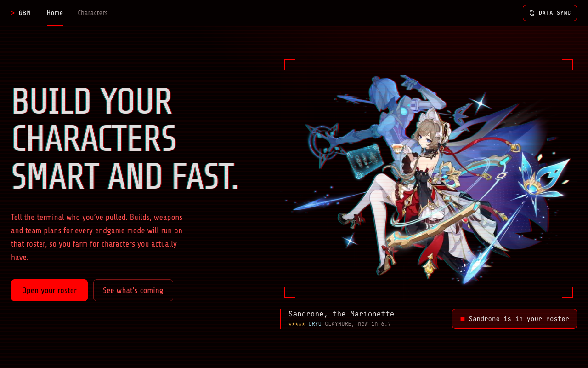

## What you can do

### Track your roster

The **Characters** page lists every playable character through version 7.1. Click a card to mark it as owned. The counter at the top shows how much of the roster you have, split by 5★ and 4★.

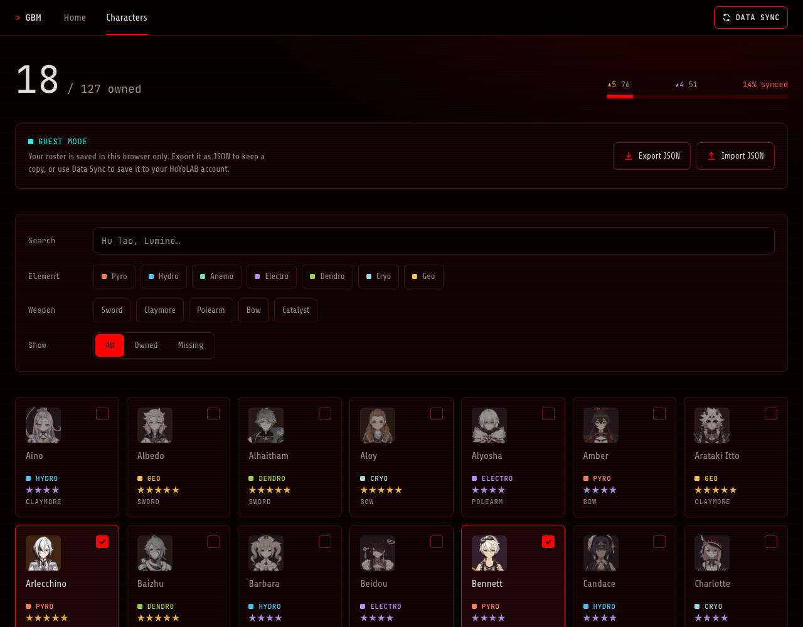

### Filter and search

Search by name, or narrow the list by element, weapon type and owned/missing. **Clear filters** resets everything.

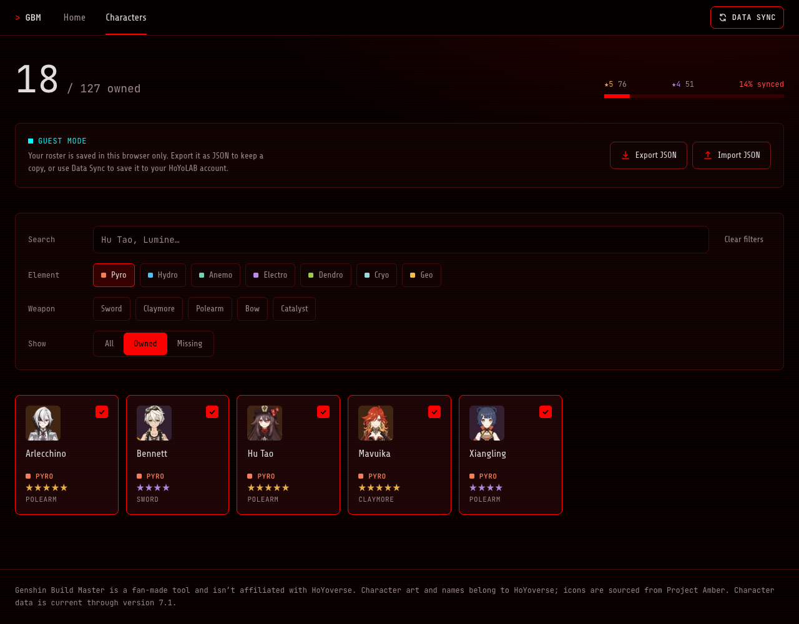

### See your progress at a glance

The home page sums up your roster and shows the characters you added most recently.

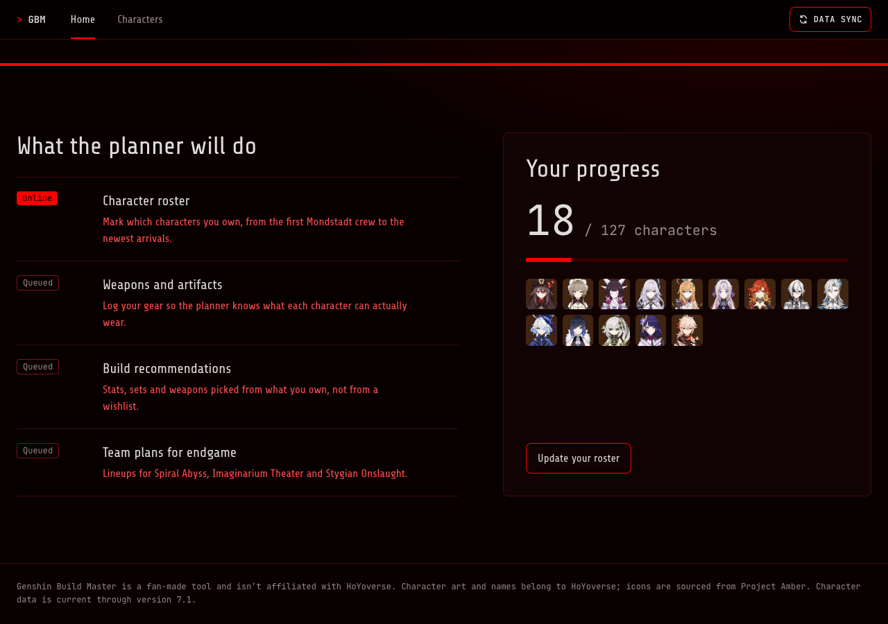

### Use it without an account

You don't need to sign in. As a guest, your roster is saved in your browser. Use **Export JSON** to download a copy and **Import JSON** to load it back, on this device or another one. Importing adds characters to your roster and never removes any.

### Sign in with HoYoLAB (Data Sync)

Click **Data Sync** in the navbar and paste two cookies from [hoyolab.com](https://www.hoyolab.com):

1. Open hoyolab.com while logged in.
2. Open DevTools → Application → Cookies → `.hoyolab.com`.
3. Copy `ltuid_v2` and `ltoken_v2` into the form.

UID and server are optional; the app finds them for you. Tick **Remember me** to stay signed in on that device for 30 days.

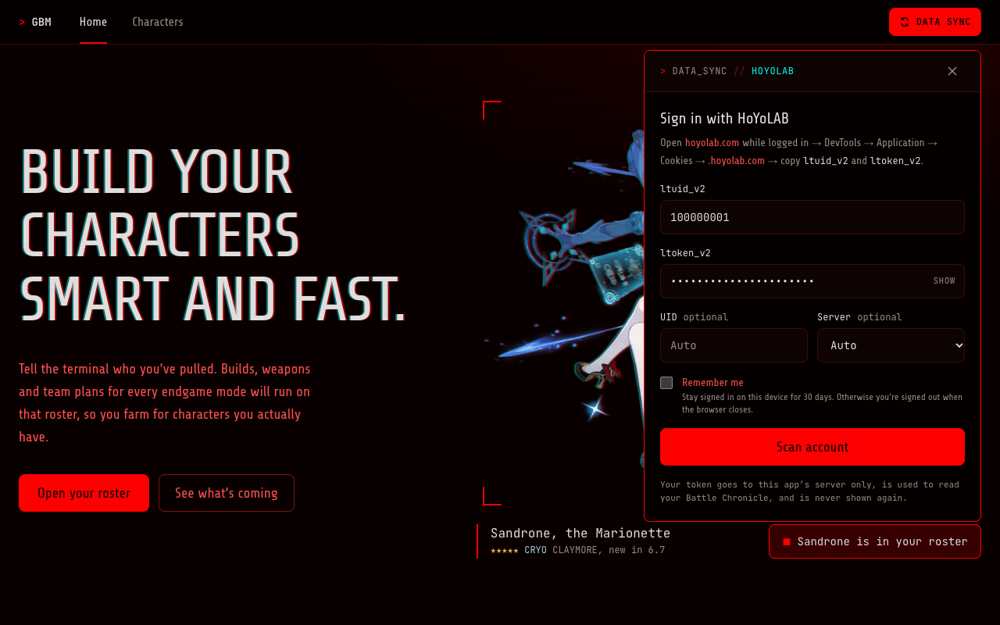

**Scan account** looks you up and shows your profile card: your in-game picture, achievements, character count, and this season's Spiral Abyss, Imaginarium Theater and Stygian Onslaught results. Click **Yes, that's me** to sign in, or **Not me** to go back.

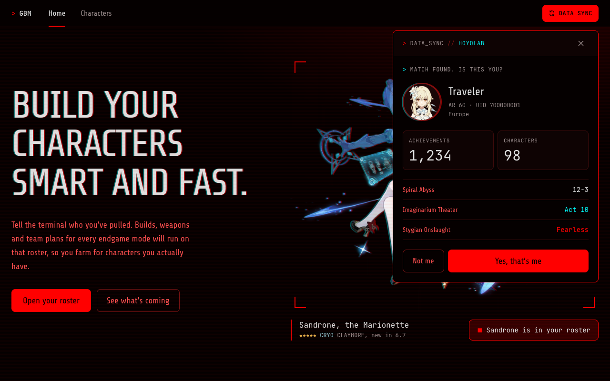

When you sign in:

- Every character your HoYoLAB account owns is ticked automatically.
- Anything you ticked as a guest is added to your account.

### Your account menu

Once you're signed in, the Data Sync button turns into your profile picture. Click it to:

- **Sync characters**: pull your roster from HoYoLAB again, for example after a new pull. It only adds ticks; characters you ticked by hand stay ticked.
- **Sign Out**: forget your HoYoLAB login on every device.

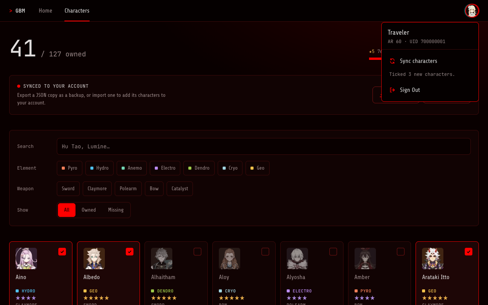

### Inspect a character's build (Character Details)

Once you're signed in, **Character Details** lists your characters in a sidebar. Search it, or on a phone swipe through it. Pick one to see how they're built right now, read from your Battle Chronicle:

- **Overview**: splash art, level, constellation and friendship, talent levels, and which constellations are unlocked.
- **Weapon**: refinement, level, and its main stat and substat.
- **Stats**: the totals with your weapon and artifacts on (HP, ATK, DEF, Elemental Mastery, crit, Energy Recharge, elemental damage), each split into base and bonus.
- **Artifacts**: every piece with its main stat and substats. Dots show how many upgrades went into each substat. Active set bonuses are listed, plus a crit value score (CV = 2 × CRIT Rate + CRIT DMG, from substats).

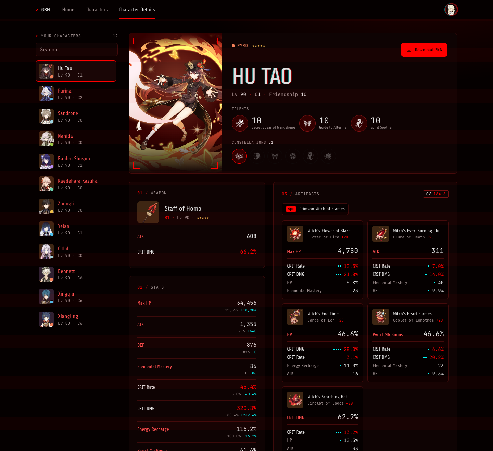

### Share your build as an image

Click **Download PNG** to save the build as a 1600×900 card, ready to post or send to friends.

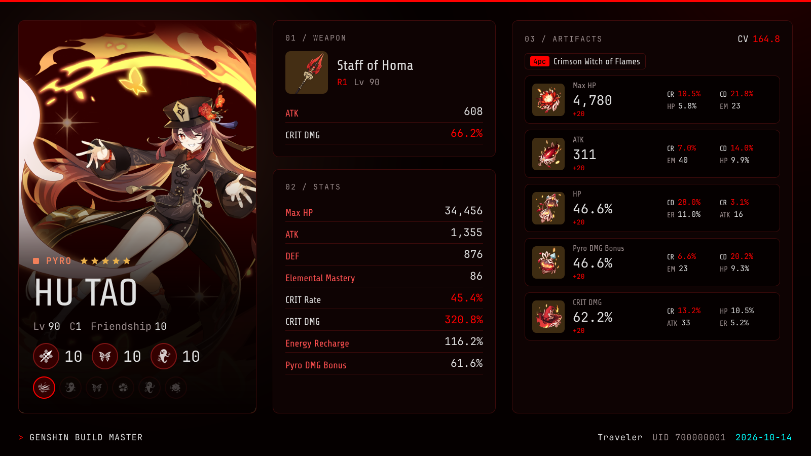

### Works on your phone

Every page is built for small screens too, down to 320px wide.

<p>
  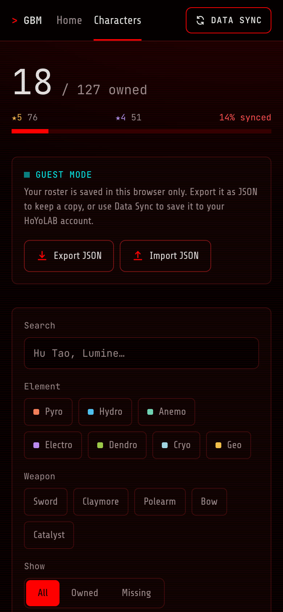
  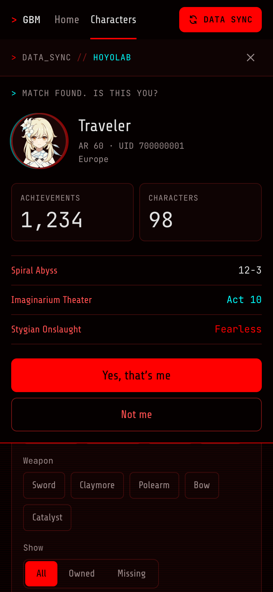
  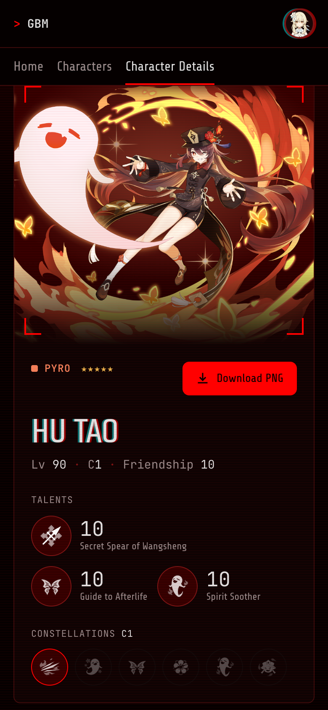
</p>

## Your HoYoLAB login and privacy

- Your `ltoken_v2` works like a password. It's sent only to this app's own server, which uses it to read your Battle Chronicle. It's never shown again, logged, or put in a URL.
- Without **Remember me**, your login is kept only in the server's memory and is gone when you close the browser.
- With **Remember me**, the token is stored encrypted in the database for 30 days.
- **Sign Out** deletes your stored login and any cached HoYoLAB data.
- If you're a guest, nothing about you leaves your browser.

## Setup

Requires Node 24+ and Docker Desktop.

```bash
npm install
cp .env.example .env
npm run db:up
npm run db:migrate
npm run db:seed
npm run dev
```

Open http://localhost:3000.

For **Remember me** to work, set `HOYOLAB_SESSION_KEY` in `.env` to the output of this command. It's an encryption key for this server, not a HoYoLAB credential:

```bash
openssl rand -base64 32
```

Run the tests with `npm test`.

---

Genshin Build Master is a fan-made tool and isn't affiliated with HoYoverse. Character art and names belong to HoYoverse; icons are sourced from Project Amber. Screenshots use demo data, with game art from Project Amber.
